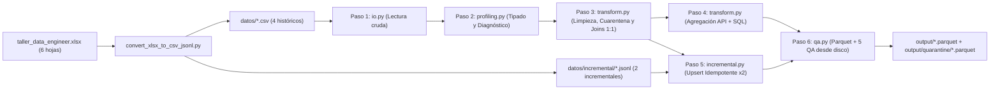

# Taller Local: Data Engineer Junior Advanced (PySpark & Spark SQL)

Pipeline ETL local desarrollado en **Python + PySpark + Spark SQL** para procesar las ventas de una tienda latinoamericana (datos sintéticos), aplicando perfilamiento de datos, limpieza con trazabilidad total (cero descartes silenciosos), agregación distribuida sin duplicación de importes, ingestión incremental idempotente y controles de calidad verificados directamente sobre archivos Parquet.

---

## Requisitos previos

- **Python 3.12**
- **Java JDK 17, 21 o 25** (`java -version`)
- **PySpark 4.3.0**

No requiere cuenta cloud, Azure, Databricks, Docker ni Delta Lake.

---

## Instalación y comandos de ejecución

### 1. Crear y activar el entorno virtual (si aún no existe `.venv`)

```bash
# Linux / macOS
python3.12 -m venv .venv
source .venv/bin/activate
python -m pip install pyspark==4.3.0
```

```powershell
# Windows (PowerShell)
py -3.12 -m venv .venv
.venv\Scripts\Activate.ps1
python -m pip install pyspark==4.3.0
```

### 2. Verificar que Spark inicia localmente

```bash
.venv/bin/python -c "from pyspark.sql import SparkSession; s=SparkSession.builder.master('local[2]').appName('check').getOrCreate(); print('Spark:', s.version); s.stop()"
```

### 3. (Opcional) Extraer los CSV y JSONL desde el Excel oficial

Los archivos ya están extraídos en `datos/`. Si deseas regenerarlos desde `taller_data_engineer.xlsx` (las 6 hojas):

```bash
.venv/bin/python convert_xlsx_to_csv_jsonl.py taller_data_engineer.xlsx
```

### 4. Ejecutar el pipeline ETL completo

```bash
# Con el entorno activado:
python etl_taller.py

# O directamente sin activar el entorno:
.venv/bin/python etl_taller.py
```

---

## Arquitectura modular del proyecto

```text
taller-spark/
├── README.md                        # Documentación, comandos y tabla de flujo
├── Taller Spark.pdf                 # Consigna oficial y criterios de aceptación
├── taller_data_engineer.xlsx        # Dataset fuente (6 hojas relacionadas)
├── convert_xlsx_to_csv_jsonl.py     # Extractor de las 6 hojas del Excel a datos/
├── etl_taller.py                    # Orquestador principal (punto de entrada)
├── etl/
│   ├── __init__.py                  # Definición del paquete
│   ├── config.py                    # SparkSession local (UTC), rutas y constantes
│   ├── io.py                        # Lectura cruda (inferSchema=False), tipado ANSI-safe y escritura Parquet
│   ├── profiling.py                 # Paso 2: perfilamiento y diagnóstico de anomalías
│   ├── transform.py                 # Pasos 3 y 4: limpieza, cuarentena, joins 1:1 y agregación API + SQL
│   ├── incremental.py               # Paso 5: upsert incremental idempotente + prueba de reproceso
│   └── qa.py                        # Paso 6: guardado en output/ y 5 Controles de Calidad desde disco
├── datos/
│   ├── customers.csv                # 1,001 filas (hoja 1: clientes)
│   ├── products.csv                 # 100 filas (hoja 2: productos)
│   ├── orders.csv                   # 20,001 filas (hoja 3: pedidos)
│   ├── order_items.csv              # 40,026 filas (hoja 4: detalle_pedidos)
│   └── incremental/
│       ├── orders_incremental.jsonl       # 101 filas (hoja 5: 100 nuevos + 1 actualización tardía)
│       └── order_items_incremental.jsonl  # 200 filas (hoja 6: líneas incrementales)
└── output/                          # Resultados Parquet y tablas de cuarentena
```

---

## Tabla de flujo del pipeline ETL

| Paso | Módulo / Función | Entradas | Transformación y reglas de negocio | Salidas / Artefactos |
| :--- | :--- | :--- | :--- | :--- |
| **0. Extracción (opcional)** | `convert_xlsx_to_csv_jsonl.py` | `taller_data_engineer.xlsx` (6 hojas) | Extrae hojas 1–4 a CSV y hojas 5–6 a JSON Lines (Spark no lee `.xlsx` nativamente). | `datos/*.csv` y `datos/incremental/*.jsonl` |
| **1. Lectura cruda** | `etl/io.py` → `read_historical_raw()` | 4 CSV en `datos/` | Lectura local con `master("local[*]")`, `header=True`, `inferSchema=False` (todo string). | DataFrames crudos históricos + esquema verificado |
| **2. Perfilamiento** | `etl/profiling.py` → `profile_and_diagnose()` | DataFrames crudos | Tipado explícito seguro (`try_cast`, `try_to_date`, `try_to_timestamp`), normalización de textos y diagnóstico de **7 tipos de anomalías** con política definida. | DataFrames tipados + reporte de anomalías |
| **3. Limpieza, cuarentena y enriquecimiento** | `etl/transform.py` → `clean_and_enrich_historical()` | DataFrames tipados | Deduplicación determinística por PK (`customer_id`, `product_id`, `order_id`, `line_id`), corrección `deliverd → delivered`, separación explícita en cuarentena con `quarantine_reason`, joins 1:1 sin multiplicación de importes y cálculo de `net_amount = quantity * unit_price * (1 - discount_pct)` en `Decimal(18,2)`. | Dimensiones/hechos limpios, `sales_detail` histórico (39,190 líneas), cuarentenas y cuadre contable |
| **4. Agregación** | `etl/transform.py` → `aggregate_sales()` | `sales_detail` histórico | Agregación por `(order_month, country, channel, category)` con DataFrame API y Spark SQL; validación de equivalencia exacta (`exceptAll == 0`). | Resumen mensual histórico (144 combinaciones, `$95,297,643.79`) |
| **5. Incremental idempotente** | `etl/incremental.py` → `run_incremental_pipeline()` | Limpios históricos + 2 JSONL en `datos/incremental/` | Upsert por `order_id` conservando el `updated_at` más reciente (actualización tardía de `O00005` a `2026-03-05 12:00:00 UTC`), upsert por `line_id`, cuarentena de las 4 líneas incrementales hacia `P088`/`P089`, re-enriquecimiento, re-agregación y **2ª corrida de prueba** con el mismo lote para demostrar idempotencia exacta. | Tablas consolidadas (`20,097` pedidos, `39,386` líneas, `$95,703,942.43`) + reporte de idempotencia |
| **6. Persistencia y QA** | `etl/qa.py` → `save_and_run_qa()` | Agregados, tablas consolidadas y cuarentenas | Escritura en Parquet bajo `output/`, relectura desde disco y ejecución de **5 controles QA** con `assert`. | 7 datasets Parquet en `output/` y `output/quarantine/` |

### Diagrama de flujo



---

## Decisiones de calidad (cero descartes silenciosos)

| Entidad | Anomalía detectada | Acción aplicada |
| :--- | :--- | :--- |
| **Clientes** (`1,001`) | `C0020` duplicado (1 fila extra) | **Deduplicar** por `customer_id`. |
| **Clientes** | `C0013` con `email` vacío/nulo | **Conservar** (no afecta dimensiones ni métricas de ventas). |
| **Productos** (`100`) | `P088` (`unit_price = -12.50`) y `P089` (`unit_price` nulo) | **Cuarentena** (`INVALID_OR_NULL_UNIT_PRICE`). |
| **Pedidos** (`20,001`) | `O00012` duplicado (1 fila extra) | **Deduplicar** por `order_id` conservando el `updated_at` más reciente. |
| **Pedidos** | `O00030` con `status = 'deliverd'` | **Corregir** a `'delivered'`. |
| **Pedidos** | `O00025` con fecha inválida (`2026-99-31`), `O00011` (`customer_id` nulo), `O00007` (`C9999` huérfano) | **Cuarentena** (`INVALID_ORDER_TS`, `NULL_CUSTOMER_ID`, `ORPHAN_CUSTOMER_ID`). |
| **Líneas** (`40,026` hist + `200` inc) | `quantity <= 0` (`L0000001`, `L0000002`), `discount_pct > 1` (`L0000005`), FKs huérfanas (`L0000003`, `L0000004`) y referencias a productos/pedidos en cuarentena (`831` hist + `4` inc) | **Cuarentena** con motivo exacto (`output/quarantine/order_items_quarantine.parquet`, `840` registros en total). |

---

## Controles de Calidad (QA) implementados

1. **QA 1 — Reconciliación matemática exacta:** `SUM(net_amount)` en detalle == `SUM(total_net_sales)` leído desde Parquet (`Diff = $0.0000`, en `Decimal(18,2)`), tanto histórico como consolidado.
2. **QA 2 — Unicidad e integridad dimensional en disco:** 0 claves `(order_month, country, channel, category)` duplicadas, 0 nulos, todas las métricas positivas, verificado tras releer los Parquet desde `output/`.
3. **QA 3 — Prevención de duplicación en joins:** granularidad 1:1 exacta (`filas_detalle == countDistinct(line_id)`).
4. **QA 4 — Cero descartes silenciosos:** cuadre contable exacto (`entrada == limpios + deduplicados + cuarentena`) en las 4 tablas históricas y el lote incremental, validado contra los archivos de cuarentena en disco.
5. **QA 5 — Idempotencia y actualización tardía:** reprocesar el lote incremental produce exactamente los mismos conteos e importes (`Corrida 1 == Corrida 2`) y el pedido `O00005` conserva una sola fila con `updated_at = 2026-03-05 12:00:00 UTC`.

---

## Salidas generadas en `output/`

- `output/ventas_mensuales.parquet` — Resumen mensual histórico (`144` filas).
- `output/ventas_mensuales_consolidadas.parquet` — Resumen mensual histórico + incremental (`208` filas).
- `output/orders_consolidated.parquet` — Pedidos consolidados idempotentes (`20,097` filas).
- `output/order_items_consolidated.parquet` — Líneas consolidadas idempotentes (`39,386` filas).
- `output/quarantine/products_quarantine.parquet` — Productos en cuarentena (`2` filas).
- `output/quarantine/orders_quarantine.parquet` — Pedidos en cuarentena (`3` filas).
- `output/quarantine/order_items_quarantine.parquet` — Líneas en cuarentena histórico + incremental (`840` filas).
